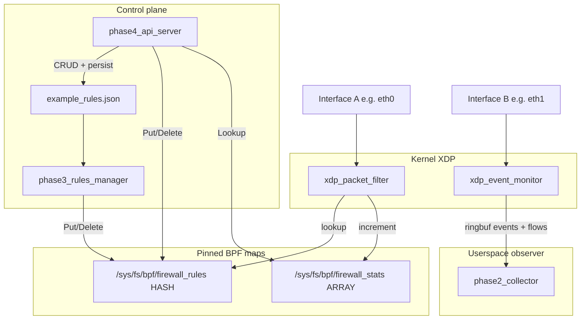

# eBPF Firewall — Structure and Architecture

This is a **modular host firewall** built on Linux **XDP** (eXpress Data Path). Each phase is an independent Go binary (plus C eBPF objects for phases 1–2). There are **no Kubernetes manifests, CRDs, or DaemonSets** in the repo — the parent folder name is context, not a deployed k8s dataplane.

**Runtime needs:** Linux kernel **5.8+**, `clang`/`llvm`, `libbpf`, Go **1.22+**, `github.com/cilium/ebpf` v0.15.0. Windows workspaces can hold the Go sources; C eBPF objects must be built on Linux.

Operational steps: [QUICKSTART.md](QUICKSTART.md). File and command index: [FILES_INDEX.md](FILES_INDEX.md). Original design notes: [ebpf-firewall-design.md](ebpf-firewall-design.md).

---

## Repository structure

```
ebpf-firewall/
├── Makefile
├── README.md
├── .gitignore
├── docs/
│   ├── ARCHITECTURE.md
│   ├── ebpf-firewall-design.md
│   ├── QUICKSTART.md
│   └── FILES_INDEX.md
├── phase1/   data path (XDP filter)
├── phase2/   observability (XDP pass-through + ringbuf)
├── phase3/   file-driven policy
└── phase4/   REST control plane
```

| Path | Role |
|------|------|
| [phase1/phase1_packet_filter.c](../phase1/phase1_packet_filter.c) | Kernel XDP program: parse IPv4, lookup rules, `XDP_DROP` / `XDP_PASS` |
| [phase1/phase1_loader.go](../phase1/phase1_loader.go) | Load `.o`, pin maps, attach XDP (generic mode) |
| [phase2/phase2_ringbuf_events.c](../phase2/phase2_ringbuf_events.c) | Observe-only XDP: ring buffer events + LRU flow map |
| [phase2/phase2_collector.go](../phase2/phase2_collector.go) | Userspace ringbuf reader / live printer |
| [phase3/phase3_rules_manager.go](../phase3/phase3_rules_manager.go) | Validate JSON, rewrite pinned `firewall_rules`, poll for hot-reload |
| [phase3/example_rules.json](../phase3/example_rules.json) | Sample allow/drop rules (SSH/HTTP/DNS allow; ICMP/Telnet/RDP/SMB/…) |
| [phase4/phase4_api_server.go](../phase4/phase4_api_server.go) | HTTP CRUD + stats; dual-write JSON file and BPF map |

Each phase has its own `go.mod` (`ebpf-firewall/phaseN`). Build: `make all` / `make phase1`–`phase4`.

---

## Layered architecture



Linux allows **one XDP program per interface**. Phase 1 and Phase 2 cannot share the same NIC. Typical run: Phase 1 on `eth0`, Phase 2 on `eth1`.

**Startup order:** Phase 1 must run first — it creates and pins the maps. Phase 3 fails if the pin is missing. Phase 4 can start in **file-only mode** (rules on disk, not enforced) until Phase 1 is up.

---

## Data path (Phase 1)

`xdp_packet_filter` on each IPv4 packet:

1. Bump `STAT_TOTAL`.
2. Non-IPv4 → `XDP_PASS` (counted allowed).
3. Extract protocol; for TCP/UDP, destination port.
4. Lookup `{protocol, dst_port}` in `firewall_rules`.
5. Miss → lookup `{protocol, 0}` (protocol wildcard).
6. Still miss → **default policy**: drop ICMP, allow everything else.
7. `ACTION_DROP` → `XDP_DROP`; else `XDP_PASS`. Hits increment `match_count`.

Protocols: `1` ICMP, `6` TCP, `17` UDP, `0` any.

Loader ([phase1_loader.go](../phase1/phase1_loader.go)): `PinByName` for `firewall_rules` and `firewall_stats` under `/sys/fs/bpf`, attach with `link.XDPGenericMode` by default, or `-driver-mode` for `XDPDriverMode`. Prints counters every 5s. Detaches on SIGINT; **pins remain** until `sudo rm`. The `.o` file defaults to next to the loader binary so `./phase1/phase1-loader -interface eth0` works from the repo root after `make phase1`.

---

## Observability (Phase 2)

Independent XDP program: **never drops**. Updates LRU `flows` (8k 5-tuples) and submits `packet_event` to a 256KB ring buffer. `verdict` is always `0xFF` (unknown) — it does not share Phase 1’s decision. Maps are **not pinned** (process-local). Collector prints per-packet lines and periodic `events/bytes/flows`.

---

## Policy and control (Phases 3–4)

**Shared C/Go layout** (must stay identical; C is *not* packed):

- `rule_key`: `protocol` + pad + `dst_port` (size 4)
- `rule_value`: `action` + 7-byte pad + `match_count` (uint64)

**Phase 3:** JSON `{id, protocol, dst_port, action, description}` → validate → **wipe map** → rewrite all keys. Polls file mtime (default 10s). Map keys are only proto+port; **IDs live only in the JSON file**.

**Phase 4:** in-memory `map[id]Rule` + optional seed from file. Writes both the JSON file and the pinned map. Endpoints:

- `GET /health` — map attachment flags
- `GET /api/v1/stats` — packet counters + rule count
- `GET/POST /api/v1/rules`
- `PUT/DELETE /api/v1/rules/{id}`

**Auth and TLS.** `/health` is public. `/api/v1/*` requires `Authorization: Bearer` or `X-API-Token` unless `-allow-insecure-no-auth` is set. Default listen is `127.0.0.1:8080`. HTTPS is enabled with `-tls-cert`/`-tls-key`. Plain HTTP off loopback requires `-allow-insecure-http` (trusted reverse proxy). Rules files are written mode `0600`.

Phase 3 and 4 can both write the same map (file/GitOps vs HTTP). Concurrent use can race: Phase 3’s full wipe vs Phase 4’s incremental CRUD.

`-seed` loads the rules file into **API memory only**. It does not push every rule into the BPF map. Phase 3 is the bulk map loader.

---

## Maps

| Map | Type | Pin | Writer | Reader |
|-----|------|-----|--------|--------|
| `firewall_rules` | HASH 1024 | `/sys/fs/bpf/firewall_rules` | phase3, phase4 | phase1 kernel, phase3, phase4 |
| `firewall_stats` | ARRAY 4 | `/sys/fs/bpf/firewall_stats` | phase1 kernel | phase1 printer, phase4 |
| `events` | RINGBUF | none | phase2 kernel | phase2 collector |
| `flows` | LRU_HASH 8192 | none | phase2 kernel | phase2 collector |

Stats indexes: 0 total, 1 dropped, 2 allowed, 3 icmp_dropped.

---

## What this is not

- Not a Kubernetes NetworkPolicy engine, CNI, or sidecar mesh.
- No IPv6, no L7, no source-IP/CIDR matching (key is dest proto+port only).
- No combined filter+monitor on one NIC (would need `bpf_tail_call` or one merged XDP program).
- Phase 4 seed loads the file into memory but does not push all rules into the BPF map on startup unless each CRUD path runs — Phase 3 is the intended bulk map loader.

---

## Suggested runtime topology

Build: `make all` (or `make userspace` then `make bpf` on Linux). Run the four processes, or `scripts/run-topology.sh` (`IFACE_FILTER`, `IFACE_MONITOR`, `LISTEN`).

1. `sudo ./phase1/phase1-loader -interface eth0`
2. `sudo ./phase3/phase3-rules-manager -rules phase3/example_rules.json`
3. `FIREWALL_API_TOKEN=... ./phase4/phase4-api-server -listen 127.0.0.1:8080 -rules-file phase3/example_rules.json -seed`
4. Optional: `sudo ./phase2/phase2-collector -interface eth1`
